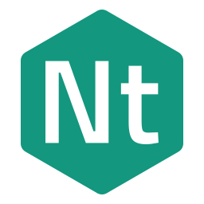
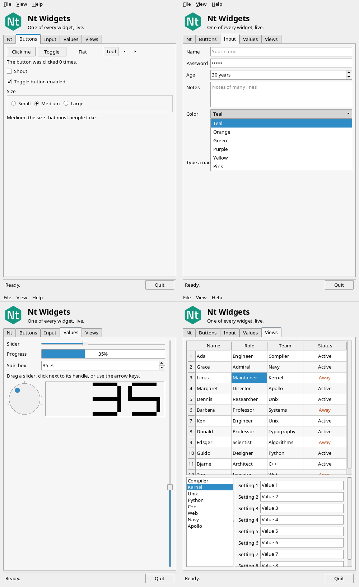
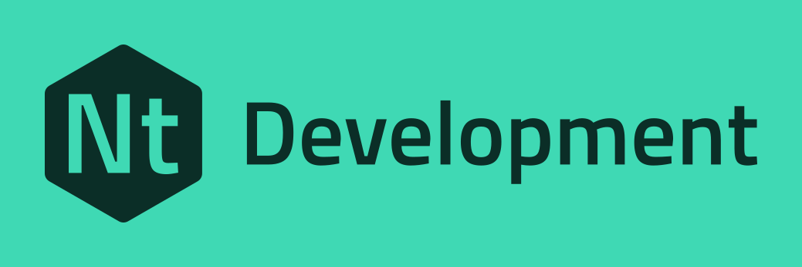

<p align="center"></p>

<h1 align="center">Open Nt</h1>

<p align="center"><b>The Qt 6 API, rebuilt from scratch under the MIT licence.</b></p>

<p align="center">
<a href="https://github.com/open-nt/Nt6">Source</a> ·
<a href="https://open-nt.github.io/Nt6/">Documentation</a> ·
<a href="https://github.com/open-nt/Nt6/issues">Issues</a> ·
<a href="https://snapcraft.io/open-nt6">Snap</a> ·
<a href="https://github.com/sponsors/ross-newman">Sponsor</a>
</p>

---

## What is Nt?

**Nt** (say "nut") is a clean-room implementation of the Qt 6 C++ API. The classes and
headers keep their Qt names, so code written for Qt compiles against Nt unchanged:

```cpp
#include <QCoreApplication>
#include <QTimer>

int main(int argc, char **argv)
{
    QCoreApplication app(argc, argv);
    QTimer::singleShot(1000, &app, &QCoreApplication::quit);
    return app.exec();
}
```

What makes Nt different:

- **MIT licensed.** Link it statically, ship it in closed-source products, change it. There are
  no LGPL or GPL obligations.
- **Written from scratch.** No Qt source code is used, and the documentation is written from
  Nt's own behaviour.
- **Small.** Nt is built module by module, from plain C++17 and CMake. It ships its own
  meta-object compiler, `ntmoc`, and its own documentation generator, `ndoc`.
- **Honest about gaps.** Every class's reference page lists how it differs from Qt.

Nt has these modules today: **Nt Core**, **Nt Network**, **Nt Serial Port**, **Nt D-Bus**,
**Nt HTTP Server**, **Nt WebSockets**, **Nt GUI**, **Nt Widgets** and **Nt Test**. It targets
Linux first, with Android, Windows and macOS planned.

<p align="center">
<picture>
  <source media="(prefers-color-scheme: dark)" srcset="assets/hello-widgets-dark.png">
  
</picture>
</p>

<p align="center"><i>The <code>hello_widgets</code> example, drawn entirely by Nt Widgets.</i></p>

---

<p align="center">
<picture>
  <source media="(prefers-color-scheme: dark)" srcset="assets/nt-development-logo-neon.svg">
  
</picture>
</p>

## Contributors wanted

Nt is young, and there is far more of Qt to cover than one person can write. If you know Qt,
C++ or a platform that Nt does not support yet, there is a part of Nt that needs you.

### Where to help

| Area | What needs doing |
|---|---|
| **Nt Core** | Item models (`QAbstractItemModel` and the proxy models), `QFuture`/`QPromise` and QtConcurrent, `QXmlStreamReader`/`Writer`, CBOR, `QLibrary`/`QPluginLoader`, the animation framework |
| **Nt GUI and Widgets** | More widgets and views, styles, accessibility, drag and drop |
| **Platforms** | Windows, macOS and Android ports. The platform code is kept separate so this can start now |
| **Real applications** | Build your Qt application against Nt and report what is missing or behaves differently |
| **Documentation** | Examples, tutorials and corrections to the reference pages |
| **Testing** | More tests for edge cases, and runs on distributions and compilers that CI does not cover |

Pick something from the **Nt Core: not implemented yet** list in the
[README](https://github.com/open-nt/Nt6#nt-core-not-implemented-yet), or from the
[issues](https://github.com/open-nt/Nt6/issues). If you are not sure where to start, open an
issue and say what interests you.

### How to start

```sh
git clone https://github.com/open-nt/Nt6.git
cd Nt6
cmake -S . -B build && cmake --build build && ctest --test-dir build
./check.sh --install-hook      # runs the quality gate before every commit
```

Every change goes through `./check.sh`: a `-Werror` build, the tests, complete `ndoc`
documentation, clang-format, clang-tidy, cppcheck, and the tests again under AddressSanitizer,
UBSan and ThreadSanitizer. CI runs the same script on Ubuntu 22.04, 24.04 and 26.04,
Enterprise Linux 9 and 10, and Arch Linux.

A few rules keep Nt clean-room and maintainable:

- **Write from behaviour, not from Qt's source.** Do not copy or paraphrase Qt code or Qt
  documentation. Nt has to stay free of it.
- **New public API comes with `ndoc` comments and tests** in the same pull request.
- **Say how it differs.** Each class documents its differences from Qt in a
  `\differences` block.
- Source files start with `// MIT License - see LICENSE`.

The project's
[AGENTS.md](https://github.com/open-nt/Nt6/blob/main/AGENTS.md) has the full conventions.

### Other ways to help

- **Star** [Nt6](https://github.com/open-nt/Nt6) so that more Qt developers find it.
- **Sponsor** the work through [GitHub Sponsors](https://github.com/sponsors/ross-newman).
- **Tell people.** Try it, write about it, and share what you build.

---

<sub>Nt is an independent project. It is not affiliated with, endorsed by or connected to The Qt
Company. Qt is a registered trademark of The Qt Company Ltd. The Nt name and logos are MIT
licensed; see the <a href="https://open-nt.github.io/Nt6/brand.html">Nt Brand Guide</a>.</sub>
